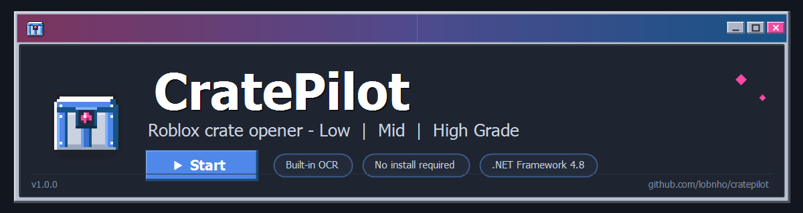

<p align="center">
  
</p>

# CratePilot

Assistente portátil para acompanhar a abertura de caixas **Low, Mid e High Grade** no Roblox usando captura da janela, OCR e ações visíveis. Não modifica o jogo, não acessa sua memória e não compra caixas.

## Interface e comportamento
- Visual Windows Classic/Orkut, Tahoma/Consolas, bordas em relevo e ícones pixelados; layout conferido em 640×480, 760×540, 880×560, 920×580 e 1040×760.
- Detecção automática do Player por processo, PID, início e árvore de janelas, sem combo de seleção manual.
- Um único botão **Iniciar/Pausar/Retomar** no rodapé e o atalho global **F9** por padrão (reconfigurável na interface) fazem o mesmo: iniciam quando parado e pausam/despausam durante a sessão. F8 não tem mais função.
- Reconhecimento do estado visível, sem uma sequência fixa de telas. Recuperar uma coleta já aberta não inventa uma abertura contada; o estoque precisa ser confirmado.
- Um log em memória, limitado a 500 entradas, com **Copiar** por ação do usuário. A execução normal não grava logs em disco; recursos OCR extraídos para cache não são logs.

## Requisitos
- Windows 10 moderno ou Windows 11, preferencialmente **64 bits**, com .NET Framework 4.8 instalado. Não requer instalar .NET 8/9, Python, Tesseract separado, Visual C++ Redistributable ou pacotes NuGet. O pacote atual é AnyCPU com payloads x64/x86; x86 é verificado em WOW64, não em Windows 32 bits físico.
- Os binários nativos são Intel/AMD x64/x86; payload ARM64 não está incluído.
- O aplicativo prefere OCR nativo do Windows quando disponível e inclui fallback Tesseract com modelo inglês para `OPEN`, `NEXT`, `CLAIM` e `Remaining`. Bibliotecas nativas, runtime C++ local e modelo são incorporados ao EXE e extraídos para uso pelo próprio aplicativo; não é preciso instalar idioma OCR no Windows.
- A compatibilidade depende também de políticas do computador, proteção antivírus, permissão para extrair o cache OCR e visibilidade da janela. Não há promessa de funcionar em qualquer PC.
- Roblox e CratePilot executados como usuário normal, sem administrador. Proteções do jogo ou políticas do computador podem impedir captura/entrada.

## Uso
1. Abra o Roblox e entre na experiência desejada. Aguarde **Roblox conectado**; títulos semelhantes não bastam para aceitar um processo.
2. No jogo, abra o menu da caixa Low, Mid ou High Grade já disponível. Deixe o conteúdo visível e sem sobreposições.
3. Confira o estado detectado e inicie. O modo automático se ressincroniza pelo conteúdo reconhecido e acompanha o estoque confirmado até zero; estados desconhecidos/ambíguos não autorizam cliques.
4. Se quiser abrir menos que todo o estoque, use a quantidade manual opcional. Ela limita o número de caixas já existentes; não compra caixas nem autoriza outros menus.
5. O botão do rodapé e o atalho de pausa (F9 por padrão, reconfigurável) iniciam quando parado e pausam/despausam durante a execução. Para encerrar antes do fim do estoque, feche a janela — ela para a sessão antes de sair. A perda de foco suspende os cliques; ao voltar ao jogo, o motor exige nova leitura antes de continuar.
6. Consulte a atividade na própria interface. **Copiar** fornece contexto da sessão e texto com redação de caminhos locais e valores sensíveis reconhecidos; confira antes de compartilhar.

O Roblox precisa permanecer visível, em primeiro plano e não minimizado durante a execução. O CratePilot pode ser minimizado se os atalhos globais estiverem registrados; mantenha uma forma de parar disponível. Não altere o tamanho, monitor ou escala da janela durante uma sequência; confira novamente a seleção se fizer isso. A velocidade é limitada também pelas animações, latência e resposta do servidor; reduzir intervalos não garante caixas instantâneas.

### Guardas de segurança
- Antes de `OPEN`, `NEXT` ou `CLAIM`, o motor descarta OCR com mais de 2 s e compara capturas pequenas atuais dos textos que sustentam a decisão. A prova visual precisa continuar recente (350 ms) até a entrada. Mudança pede nova leitura, sem clicar.
- Amostras das regiões de título, estoque, botão e prompt precisam pertencer à janela selecionada, não a uma sobreposição. O botão esquerdo humano é verificado antes de qualquer movimento e novamente antes do clique; arrastos não são assumidos pelo aplicativo.
- Pausa manual, perda de foco, minimização, oclusão confirmada e mouse humano pressionado pausam o relógio e aguardam segurança, sem forçar foco. Estado desconhecido ou imagem mudando não desliga os watchdogs.
- O padrão é parar após 25 s sem progresso visual real. Cliques repetidos, SPAM congelado e animação de fundo não renovam o progresso da fase de abertura. Existe também limite máximo por caixa. PCs cujo OCR exceda o limite de frescor podem exigir nova leitura até atingir o timeout; segurança tem prioridade sobre velocidade.

Use somente onde as regras da experiência e da plataforma permitirem. Pare ao perceber reconhecimento incorreto. Este projeto não promete evitar restrições ou penalidades do jogo.

## Compilar
Requisitos de desenvolvimento: .NET SDK 9, **.NET Framework 4.8 Developer Pack**, metadados WinRT do Windows SDK 10 (ou `Windows\System32\WinMetadata`) e payload OCR já presente em `PortableOcr/Native/x64/` e `PortableOcr/Data/eng.traineddata`. As referências locais são obrigatórias; o build não baixa dependências nem embute o runtime do Framework. O alvo é x64; passa a AnyCPU somente quando há payloads DLL para x64 e x86.

```powershell
powershell -NoProfile -ExecutionPolicy Bypass -File .\build.ps1
```

O build de produção não depende de `Tests/`, não inicia o aplicativo e não gera relatórios/imagens de teste. A saída necessária em `dist/` é **CratePilot.exe**, seu **.sha256** e os **sete avisos/licenças** em `licenses/`, que devem acompanhar a redistribuição. Bibliotecas, modelo e licenças também estão incorporados ao EXE. O build confere estabilidade dos inputs antes/depois e publica o checksum; sua saída de compilação fica apenas no console. Uma recompilação cria intermediários normais em `bin/obj`, removidos desta entrega.

## Verificação da entrega
- Antes da limpeza: **132 aprovados, zero falhas e cinco skips explícitos**, build sem avisos/erros e smoke UI exit 0. Os skips foram OCR Windows sem idiomas (disponibilidade e três imagens) e integração real de foco/minimização.
- Depois da limpeza: EXE de produção sem tipos/recursos de teste, conferido externamente em x64 e x86/WOW64 com arquivo único, 16 recursos de payload íntegros, sete avisos legais e OCR portátil em imagem sintética.
- UI diagnóstica sem motor, hotkeys, descoberta ou timers operacionais; cinco layouts com ações ≥44 DIP/footer ≥16 e fontes Tahoma/Consolas medidas pelos glifos realmente renderizados. O clipboard não foi acionado nos testes.
- Testes, hooks de autoteste/smoke, logs/relatórios, prévias e export de sessão foram removidos do projeto por solicitação do usuário. O EXE final não contém a suíte de testes; não se afirma que ela rodou dentro dele após ser removida.

Executável final: **18.451.456 bytes**, AnyCPU (payload Intel/AMD x64/x86).

```text
SHA256 9210e66a185e50fb81a07bff77b72507359ecedb7d0629818c6db9fabbab5e86
```

## Assinatura e SmartScreen
O executável está **NotSigned**. Windows SmartScreen pode avisar ou bloquear; hash não equivale a assinatura nem garante reputação. Este projeto não desativa proteções do Windows.

## Licença e marcas
- Código-fonte e interface original: **MIT** (veja `LICENSE`). A arte do aplicativo (ícone e glifos) é original, descrita em `Branding/LICENSE.txt` e `Assets/THIRD-PARTY.md`; o visual é inspiração de interfaces clássicas, sem logotipos ou imagens de terceiros.
- Os componentes OCR/redistribuíveis mantêm suas próprias licenças em `PortableOcr/Licenses/`; na distribuição, os mesmos sete avisos acompanham o executável (`dist/licenses/`).
- Roblox é marca da Roblox Corporation. CratePilot é um utilitário independente; não há afiliação, patrocínio ou endosso da Roblox Corporation. Use conforme as regras da experiência e da plataforma.

## Publicação no GitHub
- Repositório público: <https://github.com/lobnho/cratepilot>; executável pronto, `.sha256` e licenças são publicados como artefatos da release correspondente (atual: [v1.0.0](https://github.com/lobnho/cratepilot/releases/tag/v1.0.0)).
- O repositório versiona o código-fonte; `bin/`, `obj/` e `dist/` ficam fora do Git (`.gitignore`).
- O build offline (`build.ps1`) compara o digest dos inputs antes/depois da compilação e publica o checksum em `dist/CratePilot.exe.sha256`.

## Limites de verificação
Build, OCR sintético e smoke de interface são verificações locais. O jogo, menus, contagem, temporização do servidor e compatibilidade com cada experiência precisam de validação supervisionada pelo usuário. Não se afirma que Roblox foi testado automaticamente.

O fallback cobre a indisponibilidade do OCR Windows na inicialização. Se um motor Windows criado com sucesso falhar posteriormente, a sessão para com segurança; não há troca dinâmica de backend durante uma leitura. Perfis Unicode fora da code page ANSI local podem ser recusados pelo runtime nativo quando não houver caminho curto representável; o manifesto não altera globalmente a code page. Consulte `PortableOcr/README.md` para os limites e a procedência dos componentes.
